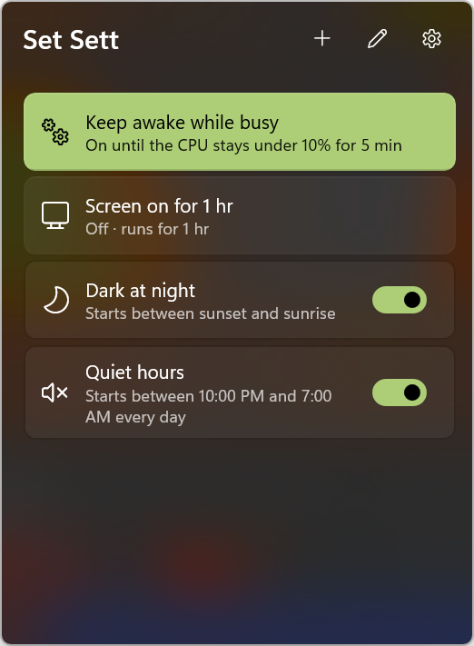
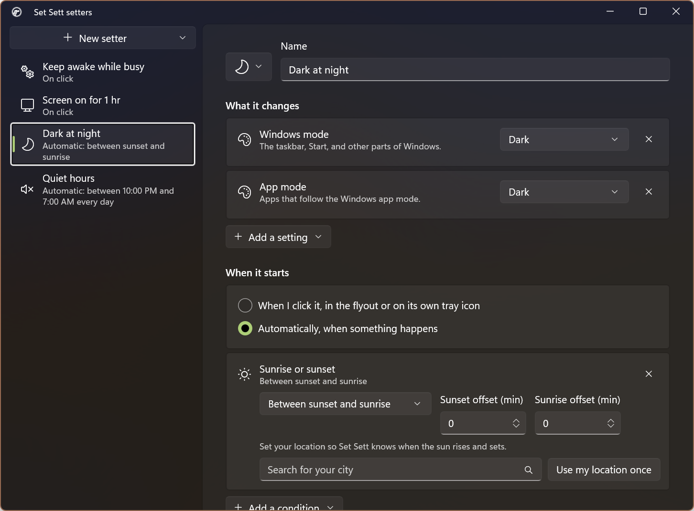

# Set Sett

Set Windows settings with one click, or let them set themselves. Set Sett is a small tray app for the settings you flip all the time: dark mode, volume, Wi-Fi, Bluetooth, when the screen turns off, keeping the PC awake. It changes them on a click, on a timer, or when something happens, and puts them back afterwards.



## What it does

You build **setters**. A setter is:

- **What it changes**: one or more settings and the values to give them.
- **When it starts**: when you click it, or automatically when something happens.
- **When it stops**: when you click it again, when its conditions end, or after any stop condition you add.
- **Afterwards**: whether to put each setting back to what it was before it started.
- **Where it shows**: a button in the flyout and, optionally, its own tray icon, which can show the time left in a timed run as a donut or a horizontal or vertical bar. You choose how the icon looks when the setter is on and when it's off: a different icon, a color, dimmed or not, and the small "on" bar.
- **Enabled**: switch a setter off to keep it without it running. A disabled setter stops if it's on, and nothing starts it. It leaves the flyout and the tray, and the editor's list shows it dimmed until you switch it back on.

| Settings it can change | |
|---|---|
| Personalization | Windows mode (light/dark), App mode (light/dark), Transparency effects |
| Sound | Volume, Mute, Microphone mute (default devices) |
| Connections | Wi-Fi, Bluetooth |
| Power | Screen off after and Sleep after (always, only when plugged in, or only on battery), Keep awake |

| Starts automatically when | Stops when |
|---|---|
| A time of day: the same hours every day (on a 24-hour dial), or each day's own hours, with any days off (on a week view) | After a while (a timer) |
| Between sunset and sunrise (or the reverse), with offsets | At a time of day |
| Connected (or not) to a Wi-Fi or wired network | The CPU has been quiet for a while ("keep awake until the render finishes") |
| A device is connected (headphones, a dock, a mouse) | An app closes |
| An app is running | At sunrise or sunset |
| Plugged in, on battery, or the battery is below or above a level | A network or device disconnects |
| At a place (when Windows location is on) | Power or battery changes |

**Putting things back.** Before changing a setting, Set Sett notes its value and saves that note to disk. When the setter stops, the setting goes back, unless you changed it yourself in the meantime, in which case your change stays. If two setters change the same setting, the last one to stop puts back what was there before either started.

**Crashes and restarts.** If Set Sett closes unexpectedly, it picks up where it left off the next time it starts. It puts back settings whose timers ran out while it was closed, and leaves alone any setting you changed yourself. "Quit" puts everything back first.

**The flyout.** Each enabled setter is a button. A click-to-start setter is a toggle. An automatic one says what it's waiting for, and offers "Stop for now" while it's on. A run with a set end shows a ring with the time left. Right-click a button to edit, disable or delete its setter.

**The tray.** Click the Set Sett icon for the flyout. Right-click it to toggle click-to-start setters, open the setter editor, open Settings, or quit. A setter's own tray icon is its glyph: full with a bar underneath while it's on, faded while it's off. Click it to start or stop the setter. If it stops at a set time ("After a while", "At a time", or a length picked from its menu), its icon can show how much of the run is left instead: a donut around the glyph, or a bar under or beside it, that empties as time goes by. If the setter is click-to-start and stops after a while, right-clicking its icon also offers other lengths ("Start for 2 hr"), 15 min to 8 hr unless you pick your own in the editor. While it's on, the same menu makes it stop that long from now ("Stop in 30 min"). The menu can also disable the setter or open it in the editor.

**Creating and editing.** Setters are built in their own window ("New setter" in the flyout or the tray menu), starting blank or from a template: *Keep awake while rendering*, *Dark mode at night*, *Screen stays on for an hour*, *Quiet hours*. Every part of a template setter—settings and values, start and stop conditions, presentation, and tray icon behavior—is defined as JSON in `SetSett.Core\Data\setter-templates.json`; the app assigns the per-user setter and tray icon ids when a template is created.

Use the editor footer's **More actions** menu to export one setter, or **Settings > Setter files**
to export every setter, as a `.sett` JSON file. Opening or importing a `.sett` file brings Set Sett
to Settings, shows what each setter changes and starts or stops on, and offers **Add all**,
**Add selected**, or **Cancel**. You can also drop one or more `.sett` files anywhere on the
editor's Settings page to start the same import review. Files written by older Set Sett versions
that contain one raw setter remain importable.



**Settings.** In the flyout and in the editor window: Start with Windows, and your location for sunrise and sunset. Pick your city from the built-in list (no permission, no network), or use your location once. The flyout shows the current place, with a link to change it in the editor window.

## Install

Coming to the Microsoft Store. Requires Windows 10 2004 or later or Windows 11, on x64 or ARM64.

## Privacy and footprint

- **No network.** Set Sett makes no network calls and the package has no internet capability. The city list ships with the app.
- **Location** is only used when you click "Use my location once" (for sun times) or "Use where I am now" (for a place condition), and for place conditions while Windows location is on for Set Sett. It never asks for location from the background. Only the place you choose is saved.
- **What's stored**, in the app's own folder: your setters (`setters.json`), what's running and what to put back (`state.json`), and your chosen place.
- **Background work.** Setters have to act while the flyout is closed, so Set Sett runs only the sensors your setters need. Network, power, and device changes come from Windows events, and the clock is a single timer. Checking for a running app polls every 5 seconds, and only while a setter is watching for one. The CPU is sampled every 10 seconds, and only while a setter with a "CPU is quiet" stop condition is on.

What Windows doesn't allow (forcing a tray icon onto the taskbar, settings with no public API) is explained in [docs/LIMITATIONS.md](docs/LIMITATIONS.md). Planned settings and conditions are in [docs/ROADMAP.md](docs/ROADMAP.md).

## Build from source

Prerequisites: the .NET 10 SDK and the winapp CLI (`winget install Microsoft.WinAppCli`).

```powershell
winapp run                                  # build and launch with package identity
winapp run --clean                          # same, starting from a clean first run
dotnet test SetSett.Tests\SetSett.Tests.csproj
```

The app project restores both `win-x64` and `win-arm64` runtimes so switching Visual Studio platforms or building a bundle does not leave a missing runtime target in the assets file.

GitHub releases come from

The solution has three projects:

- `SetSett.csproj`: the WinUI 3 tray app. Settings in `Settings\`, sensors in `Sensing\`, the host and tray icons in `Services\`, the UI in `Views\`, and custom controls (the time-of-day dial and week view) in `Controls\`.
- `SetSett.Core`: plain .NET with no Windows APIs. The setter model, conditions, the engine that starts and stops setters and puts settings back, the time-range rules behind the dial and week view, sun times, city search, and tray icon pixels.
- `SetSett.Tests`: MSTest coverage of Core.

To add a setter template, edit `SetSett.Core\Data\setter-templates.json`; no C# factory is needed. To add a setting or a condition, see "How things are added today" in [docs/ROADMAP.md](docs/ROADMAP.md#how-things-are-added-today-tier-1-plugins).

The city list (`Assets\Data\world_cities.csv`) comes from [TheJoeFin/SimpleSunriseSunset](https://github.com/TheJoeFin/SimpleSunriseSunset).

## License

MIT, see [LICENSE](LICENSE).
